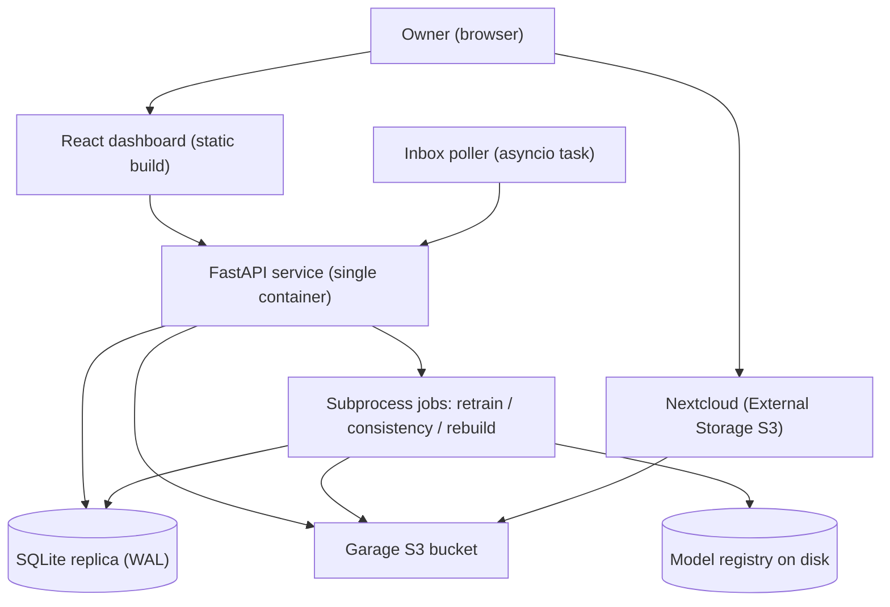
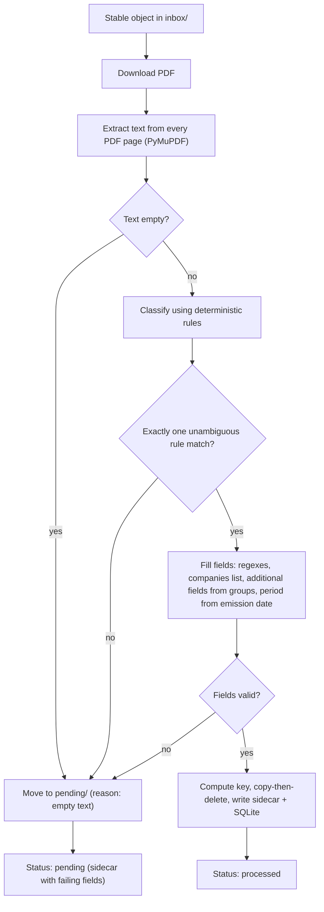
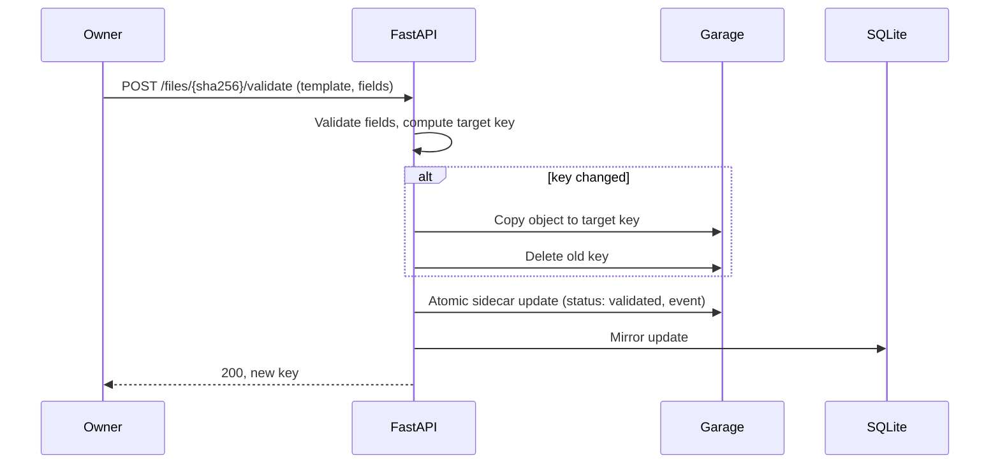

# Architecture — Automatic PDF Renamer

Architecture document derived from the PRD, following the BMAD method. Personal tool, single user, 100% offline, self-hosted.

## 1. Architecture Overview

A single Python service (FastAPI) hosts the API, the inbox poller, and the static React dashboard. It talks to a Garage S3 bucket (source of truth for objects and JSON sidecars) and mirrors metadata into a local SQLite replica.

Everything runs in one container, deployed next to the existing Garage and Nextcloud deployments. There is no message broker, no external database, and no runtime network access beyond Garage and local dashboard serving.

### 1.1 High-level view



## 2. Architecture Goals and Constraints

- Offline-first: no runtime downloads, no external services (NFR1, AC10).
- Zero silent wrong renames: every ambiguous path routes to `pending` (NFR3).
- Crash safety: copy-then-delete renames, atomic sidecar writes, SQLite repairable from sidecars alone (NFR4, AC8, AC9).
- Minimal operational surface: one container, one JSONC configuration file, env-var credentials (NFR6).
- Single user, local network: performance targets are modest (NFR2) but correctness targets are strict.

## 3. Tech Stack and Key Decisions

| Concern | Decision | Rationale |
|---|---|---|
| Language/runtime | Python 3.11+, single service | NFR7; ecosystem for ML and S3. |
| Web framework | FastAPI + Uvicorn | NFR7; async I/O for S3 polling and PDF streaming. |
| Text extraction | PyMuPDF | Fastest option; AGPL acceptable for a personal offline tool. Wrapped behind a small extractor interface so it remains swappable (PRD open question resolved). |
| S3 client | boto3 | Most complete API coverage (copy-object, versioning, ETag), mature Garage compatibility. Wrapped behind a thin storage interface; v1 ships one implementation. |
| SQLite access | SQLAlchemy ORM, WAL mode | Declared replica schema, typed models, migrations via Alembic. Sidecar remains authoritative; ORM layer only reads/writes the mirror. |
| Initial classification | Configured deterministic rules and reference data | Initial release must work without ML; TF-IDF + Logistic Regression is a post-v1 enhancement. |
| Fuzzy matching | rapidfuzz | PRD FR4.2, counterparty gazetteer. |
| Dates | python-dateutil | PRD FR4.2, emission date parsing and period computation. |
| Frontend | React + Vite, react-pdf viewer | NFR7; built to static assets served by FastAPI. |
| Process model | API, poller, and background jobs in one container | Single-user tool; a process manager is unnecessary complexity. |
| Inbox poller | asyncio background task inside the FastAPI process | Lightweight, no queue infrastructure; restart scan (FR1.3) covers crash recovery. |
| Long jobs (retrain, consistency, rebuild) | Subprocesses launched and monitored by the API | Keeps the event loop responsive; status exposed via the existing endpoints (FR9, FR10). |
| Dashboard auth | Username + password (single account, env-var credentials, session cookie) | Local network but not fully trusted; cheap to implement. |
| Testing | Unit tests only, pytest | Single-user offline tool; the storage layer is behind interfaces so mocks are cheap. Integration/CI coverage deferred. |

## 4. Components

### 4.1 Service process (single container)

One Python process runs:

- FastAPI app: serves the API, the static dashboard, and the PDF streaming proxy.
- Poller task: asyncio loop, configurable interval, lists the `inbox/` prefix.
- Job supervisor: spawns subprocesses for retrain, consistency scan, and SQLite rebuild; tracks their status in memory and in SQLite.

On startup, the process recovers interrupted technical operations and discovers eligible objects in `inbox/`. The `pending/` prefix is reconciled for metadata and anomalies; documents awaiting manual correction are not automatically reclassified or renamed until corrected/requested.

### 4.2 Module layout

```
app/
  main.py            # FastAPI app, lifespan: recovery scan + poller start
  config.py          # env vars + JSONC configuration loading
  storage/           # S3 interface (boto3), key helpers, collision suffix
  sidecar.py         # atomic sidecar write (temp key + copy), schema
  replica/           # SQLAlchemy models, sync, rebuild
  pipeline/          # extract (PyMuPDF), classify, fill fields, validate
  period.py          # period computation from emission date + period format config
  templates.py       # JSONC template registry (slots, period rules, key patterns)
  rename.py          # copy-then-delete move + event logging
  jobs/              # poller, consistency scan, retrain subprocess, rebuild
  api/               # routes: files, templates, retrain, consistency, auth
web/                 # React + Vite app (built to static assets)
models/              # versioned model registry (initial + trained)
```

### 4.3 Processing pipeline

One ingestion run, fully synchronous within the poller task:



Every terminal step writes a sidecar event (classified, renamed, corrected, validated) per FR5.2. Sidecar first, SQLite second (FR5.1); the consistency job repairs any drift after a crash.

### 4.4 Storage layer

- boto3 client pinned to the Garage endpoint, credentials from env vars.
- Interface operations: list prefix, head object, get, put, copy, delete. Rename = copy + delete, collisions resolved with an incremental suffix before the copy.
- Sidecar write: put JSON to a temp key, then copy over the final sidecar key, then delete the temp key. Never an in-place overwrite.

### 4.5 Metadata and replica

- Sidecar JSON is the sole source of truth; schema per PRD section 7 (now including the period field).
- SQLAlchemy models `files` and `consistency_flags` mirror it. `extracted_text` contains the complete text extracted from every PDF page and is stored in SQLite for full-text search alongside metadata/field search; it is a replica, and the rebuild command repopulates it from sidecars.
- `POST /consistency/rebuild` and the CLI rebuild command both clear and repopulate SQLite from all sidecars (AC9).
- Divergence resolution is always sidecar-wins (PRD 3.2); the consistency job flags drift rather than guessing.

### 4.5.1 Sidecar file format and schema

The sidecar is the authoritative metadata record for one PDF. Its schema and serialization behavior are implemented in `app/sidecar.py`; this section documents that implementation. The current schema version is `"1.0"`.

#### File naming and location

A sidecar key is derived from the PDF object key by replacing a terminal, lowercase `.pdf` extension with `.meta.json`. If the key does not end in `.pdf`, `.meta.json` is appended. For example:

- `files/invoice.pdf` → `files/invoice.meta.json`
- `inbox/document.pdf` → `inbox/document.meta.json`


#### Canonical schema example

The following is a JSONC-readable example. Comments explain the fields and are not emitted by the current serializer.

```jsonc
{
  "schema_version": "1.0", // Required. Sidecar schema version.
  "sha256": "0123456789abcdef...", // Required. SHA-256 hex digest of the PDF bytes.
  "original_key": "inbox/invoice.pdf", // Required. Original S3 object key before renames.
  "current_key": "files/acme/invoice-2026-01.pdf", // Required. Current S3 key for the PDF.
  "status": "processed", // Required. One of the three business statuses below.
  "template_name": "invoice", // Required. Template/document family selected for this PDF.
  "period_format": "monthly", // Required. Format/rule identifier used for the period string.
  "confidence": 0.97, // Serialized by the model; numeric classification confidence (0.0–1.0).
  "emission_date": "2026-01-15", // Required. Emission date; expected ISO YYYY-MM-DD.
  "period": "2026-01", // Required. Computed or validated period string.
  "emitting_company": "ACME", // Required. Normalized name of the issuing company.
  "document_type": "invoice", // Required. Fine-grained document type.
  "optional_fields": { // Serialized by the model; template-specific extracted values.
    "invoice_number": "INV-2026-001",
    "amount": 125.5,
    "currency": "EUR"
  },
  "extracted_text": "Invoice ACME ... [text from all pages]", // Complete text extracted from every page.
  "created_at": "2026-01-15T10:20:30+00:00", // Required. Creation timestamp in ISO 8601.
  "updated_at": "2026-01-15T10:21:05+00:00", // Required. Last sidecar mutation timestamp in ISO 8601.
  "events": [ // Required array; may be empty.
    {
      "type": "classified", // Event name; see supported event names below.
      "payload": {
        "template_name": "invoice",
        "confidence": 0.97
      }, // Required object; event-specific data, intentionally extensible.
      "timestamp": "2026-01-15T10:20:45+00:00" // Required ISO 8601 timestamp.
    }
  ]
}
```

#### Field definitions

| Field | Type | Presence and meaning |
|---|---|---|
| `schema_version` | string | Required. Must equal `"1.0"` in the current implementation. |
| `sha256` | string | Required. SHA-256 digest of the PDF content; used to identify content and support safe resume checks. |
| `original_key` | string | Required. S3 key where the PDF was first registered, retained across renames. |
| `current_key` | string | Required. S3 key currently associated with the PDF. |
| `status` | string | Required. One of `pending`, `processed`, or `validated`. |
| `template_name` | string | Required. Name of the configured template/document family. |
| `period_format` | string | Required. Period format/rule label, e.g. `monthly` or `yearly`. |
| `confidence` | number | Emitted by the dataclass serializer, default `0.0`. Intended for a classification score between 0 and 1; the current validator checks only that it is numeric, not that it is within that range. |
| `emission_date` | string | Required. Document emission date; `build_sidecar` documents ISO `YYYY-MM-DD`. |
| `period` | string | Required. Period derived from the emission date and applicable rules. |
| `emitting_company` | string | Required. Issuing company name. |
| `document_type` | string | Required. More specific document type within the template. |
| `optional_fields` | object | Emitted by the dataclass serializer, default `{}`. Template-specific values; values may be strings, numbers, booleans, arrays, objects, or null as allowed by the application schema. |
| `extracted_text` | string | Emitted by the dataclass serializer, default empty string. Complete text extracted from all PDF pages. |
| `created_at` | string | Required. ISO 8601 timestamp set on object construction if not supplied. |
| `updated_at` | string | Required. ISO 8601 timestamp set on construction and refreshed by `add_event` and `set_status`. |
| `events` | array of objects | Required. Chronological event history; each event has `type`, `payload`, and `timestamp`. |

The dataclass serializer emits all fields listed above, including `confidence`, `optional_fields`, and `extracted_text`, even though those three are not in the implementation's required-field set. `Sidecar.from_dict` supplies defaults for omitted fields, but `validate_sidecar` still requires the core required-field set described below.

#### Business statuses and event types

The only business statuses accepted by `validate_sidecar` are:

- `pending` — deterministic rules could not produce a valid result; the item awaits manual correction.
- `processed` — processed by the pipeline.
- `validated` — reviewed/confirmed by the owner.

Technical progress and error details must not be invented as additional business statuses. Store retry state, attempt count, next retry time, and failure details in technical processing metadata/events, separate from the three business statuses. The retry schedule is fixed: 3 retries after the initial attempt, at 5 seconds, 30 seconds, and 2 minutes. Once these retries are exhausted, stop processing that item without launching another workflow. Use `pending` only when manual correction of document classification or fields is required.

The event names declared by `EventType` are:

- `classified`
- `renamed`
- `validated`
- `corrected`
- `imported`
- `reprocessed`

Each event is an object with exactly the following required structure:

- `type`: string event name.
- `payload`: object containing event-specific details; the schema intentionally allows different payloads for different event types.
- `timestamp`: ISO 8601 timestamp generated in UTC when `Sidecar.add_event` is called.

The current validator checks that these three event properties have the correct broad types, but it does not enforce the event-name enum, timestamp parseability, or a per-event payload schema.

### 4.5.2 SQLite database schema

This section describes the schema and indexes used by the database. SQLite is a local, rebuildable metadata index; sidecars in object storage remain the source of truth. The default database path is `./renamer.db`, overridden by the `SQLITE_PATH` environment variable. The resolved parent directory is created automatically.

#### Table: `files`

The implementation should create one table, `files`. Columns are stored as follows:

| Column | SQLite type | Constraints / default | Meaning |
|---|---|---|---|
| `id` | `TEXT` | Primary key | Application record identifier. |
| `sha256` | `TEXT` | `NOT NULL UNIQUE` | PDF content digest; unique across rows. |
| `original_key` | `TEXT` | Nullable | Original object key. |
| `current_key` | `TEXT` | Nullable | Current object key. |
| `status` | `TEXT` | Nullable | Processing/business status. |
| `template_name` | `TEXT` | Nullable | Selected document template. |
| `period_format` | `TEXT` | Nullable | Period-format rule used for the document. |
| `document_type` | `TEXT` | Nullable | Document type. |
| `emitting_company` | `TEXT` | Nullable | Issuing company. |
| `period` | `TEXT` | Nullable | Computed or corrected accounting/document period. |
| `emission_date` | `TEXT` | Nullable | Document emission date. |
| `confidence` | `REAL` | Nullable | Classification confidence. |
| `optional_fields` | `TEXT` | Nullable | JSON-serialized object of template-specific fields. |
| `extracted_text` | `TEXT` | Nullable | Complete extracted document text from all pages, used by full-text search. |
| `created_at` | `TEXT` | Nullable | Creation timestamp, represented as text (normally ISO 8601). |
| `updated_at` | `TEXT` | Nullable | Last-update timestamp, represented as text (normally ISO 8601). |

SQLite does not declare SQL-level defaults for these columns beyond the constraints shown. Defaults and normalization are supplied by Python.

#### Indexes

The code should creates these named indexes :

| Index | Indexed column(s) | Purpose / usage |
|---|---|---|
| `idx_files_status` | `status` | Supports filtering by status and status-oriented listings. |

SQLite also creates an index for the `id` primary key and a unique index for `sha256` (the exact internal names are SQLite-managed).

## 4.6 Period computation

#### 4.6.1 Requirement

The system shall generate the `period` field exclusively from the document's `emission_date` and the period rule configured by the selected template. The filename shall not be used as an input to period generation or to override the generated value. The system shall parse and validate `emission_date`, apply the template's granularity, offset, and output format, and store the resulting string in `period`. If the date or rule is invalid or insufficient to generate a period, the system shall report a clear error rather than infer a value from the filename.

#### 4.6.2 Source date

`emission_date` is the sole date input for period generation. The system shall accept a date value or supported date strings, including ISO `YYYY-MM-DD`. Invalid or ambiguous values that cannot be resolved safely shall produce a validation error.

#### 4.6.3 Template period rules

The selected template shall define the period granularity and may define an offset and a custom output format.

| Property | Allowed values | Meaning |
|---|---|---|
| `granularity` | `day`, `week`, `month`, `quarter`, `semester`, `year` | Unit represented by the generated period. Defaults to `month` if omitted. |
| `offset` | `current`, `previous`, `following` | Period containing the emission date, the immediately preceding period, or the immediately following period. Defaults to `current`. |
| `format` | Template format string | Defines the final representation of the period. |

The system shall apply the offset at the selected granularity, correctly handling month, quarter, semester, year, and ISO-week boundaries. Weekly periods shall use ISO week numbering and the associated ISO week-year. Unknown granularity or offset values shall be reported as configuration errors; they shall not trigger filename-based fallback.

#### 4.6.4 Period formatting

If a custom format is defined, the system shall generate `period` by substituting supported placeholders with values derived from the emission date after applying the template's granularity and offset. Supported placeholders are:

| Placeholder | Meaning |
|---|---|
| `{year}` | Four-digit year associated with the computed period. |
| `{year_next}` / `{year_previous}` | Following / preceding calendar year. |
| `{month}` | Zero-padded month number (`01`–`12`). |
| `{month_name}` | Full French month name. |
| `{month_abbr}` | English three-letter month abbreviation. |
| `{day}` | Zero-padded day; use the first day as the representative day for month-, quarter-, semester-, and year-based periods. |
| `{quarter}` | Quarter number (`1`–`4`). |
| `{semester}` | Semester number (`1`–`2`). |
| `{week}` | ISO week number (`1`–`53`). |

When no custom format is provided, the system shall use a deterministic standard representation appropriate to the granularity, with French month names by default. An unknown placeholder shall produce a clear format error.

### 4.7 Frontend

The dashboard is served as static assets by FastAPI. Views: file list (filters, counters, badges), detail page (PDF preview and editable metadata), and a Config page for editing JSONC configuration. Saving validates the content before updating the configured file and reloading the in-memory template registry. Auth: API routes use the configured dashboard credentials.

## 5. Data Flow: Renaming and Validation



## 6. Jobs and Scheduling

| Job | Trigger | Execution |
|---|---|---|
| Inbox poll | Interval (configurable, default from PRD) | asyncio task, in-process |
| Stability check | Two consecutive listings, same size + ETag | Poller state kept in memory |
| Consistency scan | Periodic (configurable) + on demand | Subprocess |
| Retrain | Dashboard action | Subprocess; writes a new versioned model dir; activation is an atomic pointer swap, no restart (AC6) |
| SQLite rebuild | Dashboard action or CLI | Subprocess |

Subprocesses report progress and metrics by writing a status JSON consumed by the API's status endpoints. Only one job of each kind runs at a time; the API refuses a duplicate start.

## 7. Configuration and Secrets

- Templates: single JSONC file defining: document family, document types, period rules, optional field schema, extraction regexes, validation rules, key pattern, target prefix.
- Environment: S3 endpoint, access key, secret key, bucket name, poll interval, optional post-v1 ML confidence threshold, dashboard credentials, paths (SQLite file, model registry, template JSONC).
- No secrets in the JSONC; no secrets in sidecars.

## 8. Error Handling and Crash Safety

- Ingestion: classify errors as transient/retryable technical failures, permanent technical failures, or document/business validation failures. Retry transient failures up to 3 times after the initial attempt, with delays of 5 seconds, 30 seconds, and 2 minutes, using idempotent recovery. After the final retry fails, stop processing that item without another retry or review workflow. Do not set business status `pending` solely because a technical operation failed. Record technical state and error details separately from business status, and continue processing other objects.
- Rename: copy strictly before delete; a crash between the two leaves both keys, and the startup scan re-evaluates (the sidecar's current key is authoritative).
- Sidecar/SQLite: sidecar first; drift repaired by the consistency job; rebuild is always possible from sidecars alone.
- Retrain: trained models land in a new versioned directory; activation swaps an active-model pointer; a failed training run leaves the current model untouched.
- All object-not-found conditions during processing are treated as consistency anomalies and flagged (FR5.3).

## 9. Deployment

- One Docker image: Python backend + prebuilt static frontend assets + model registry. Garage and Nextcloud are pre-existing deployments on the same network; the compose file of this project only declares the renamer service.
- SQLite file and model registry on a mounted volume; container restarts are stateless otherwise.
- Offline dependency policy: all Python wheels and the frontend build are baked into the image build; the spaCy French model, if used, is vendored at build time.

## 10. Testing Strategy

- Unit tests only (pytest), per the stack decision.
- Mocked seams: storage interface (fake in-memory S3), extractor interface, classifier (fixture model), clock.
- Priority coverage: period computation (granularity/offset matrix), field validation, collision suffix logic, sidecar atomicity ordering, rebuild determinism, key pattern rendering.
- The pipeline is exercised end-to-end in unit tests with mocked S3 to validate the not-processed routing reasons.

## 11. Architectural Risks and Mitigations

| Risk | Mitigation |
|---|---|
| PyMuPDF AGPL incompatibility if the tool is ever shared | Extractor interface keeps the swap to pdfplumber cheap. |
| Garage quirks in copy-object/versioning | Storage interface isolates the client. |
| Corpus too small for reliable classification | Low-confidence routing to pending; retrain on validated files grows the corpus. |
| SQLite drift after crash | Sidecar-first ordering + consistency job + full rebuild path. |
| Single-process blast radius | Long jobs are subprocesses; the poller catches per-file exceptions. |

## 12. Traceability to PRD

Every epic maps to a component: ingestion (jobs/poller), extraction and classification (pipeline), data model and validation (templates, period, gazetteer, pipeline), renaming and logging (rename, sidecar), dashboards (web + api), template management (templates.py + config), retraining (jobs/retrain + models), consistency and recovery (jobs/consistency, replica/rebuild). Acceptance criteria AC1-AC12 are covered by the components above; AC8-AC10 by section 8, AC9 by section 4.5.
